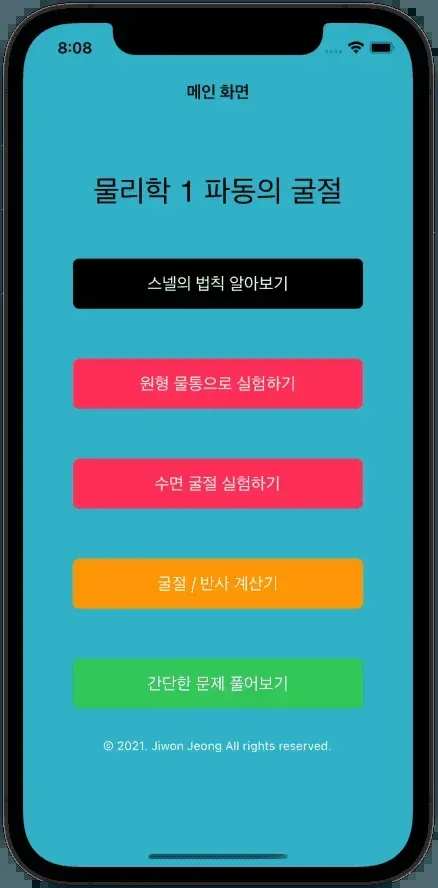
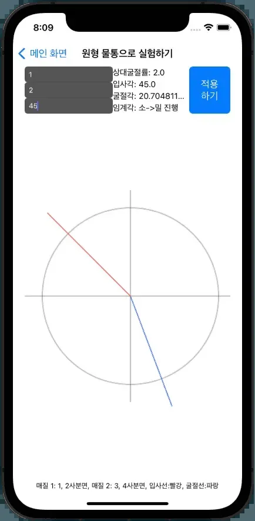
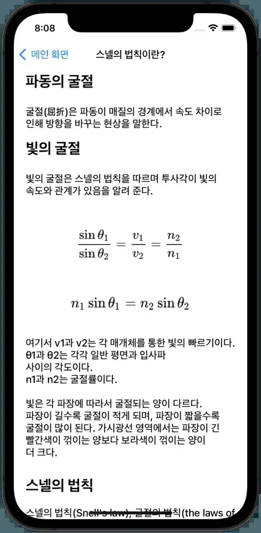

# 🌊 파동 & 굴절 학습 앱 (Wave & Refraction)

**고등학교 물리 1의 파동 굴절을 직접 조작하며 배우는 교육용 iOS 앱**

🏆 **매천고등학교 교내 소프트웨어 공모전 최우수상** (2021.12)

## 소개

고등학교 2학년 물리 수업 발표를 위해 만든 앱으로, 교내 소프트웨어 공모전에서 **최우수상**을 받았습니다. 입사각을 바꾸며 굴절이 어떻게 일어나는지 시각적으로 확인할 수 있습니다.

## 화면 구성

메인 메뉴에서 다섯 개 페이지로 이동합니다.

| 화면 | 파일 |
|---|---|
| 메인 메뉴 | `MainViewController.swift` |
| 스넬의 법칙 개념 | `SEViewController.swift` |
| 굴절 실험 (입사각 · 굴절각 · 임계각 · 상대굴절률) | `CBEViewController.swift` |
| 굴절률 · 반사각 · 임계각 계산기 | `CalcViewController.swift` |
| 문제 풀기 · 채점 | `ProbViewController.swift` |

## 실행

iOS 14.0 이상. Xcode에서 `PhysicsExperiment.xcodeproj`를 열고 실행합니다. 동작 영상은 [`test video.mov`](test%20video.mov)에 있습니다.

Version 1.1 (Beta) · Copyright 2021. Jiwon Jeong All rights reserved.
